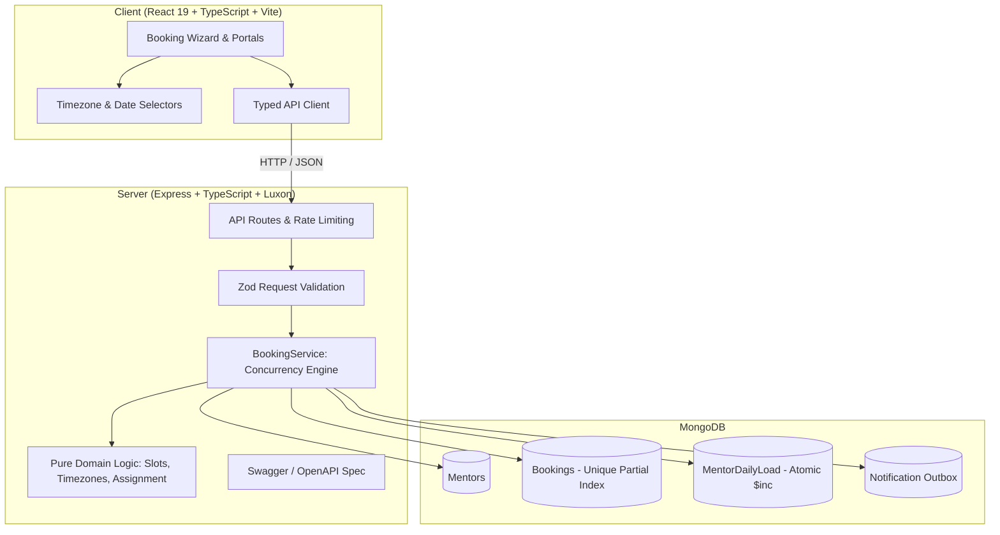

# Codeyoung Trial Class Booking System

A production-grade, demo-ready trial-class booking platform engineered for **Codeyoung**. Parents in the US, UK, and Ireland can seamlessly discover and book 1:1 live trial coding sessions with expert mentors based in India (Asia/Kolkata).

The system handles multi-continent time zones, Daylight Saving Time (DST) boundaries, strict mentor daily load caps, and high-concurrency booking races without double-booking.

---

## 🚀 Key Highlights & Architecture

- **Clean Monorepo**: Node.js/Express TypeScript backend + Vite React 19 TypeScript frontend.
- **Strict Concurrency Safety (No Replica Set Required)**: Works reliably on standalone MongoDB by combining atomic single-document operations (`$inc` on `MentorDailyLoad`) with MongoDB compound unique partial indexes (`{ mentorId: 1, slotStartUtc: 1 }` where `status: 'CONFIRMED'`) and compensation rollbacks.
- **Multi-Zone & DST Resilience**: Powered entirely by Luxon. Database stores strictly normalized UTC ISO timestamps. Slot generation respects parent local calendar days, detects Arizona (no DST), UK (BST/GMT), and US Eastern/Pacific transitions, mapping precisely to Indian Standard Time (IST, UTC+5:30).
- **Mentor Daily Capacity Rules**: Hard limit of **maximum 2 trial classes per mentor per local calendar day (IST)**.
- **Load Balancing Strategy**: Implements a pluggable `LeastLoadedStrategy` to distribute incoming trials fairly across all working mentors for each slot.
- **Idempotent Requests**: Full support for `Idempotency-Key` HTTP headers preventing duplicate bookings on double-clicks or network retries.
- **Graceful Conflict & Alternatives UX**: When a slot is taken or mentor capacity is exhausted, the API returns a structured HTTP 409 with recommended alternative slots for quick re-selection.
- **Interactive Calendar Integration**: Instant one-click RFC 5545 `.ics` file download and direct Google Calendar integration.
- **Interactive OpenAPI / Swagger Documentation**: Available at `/api/docs`.

---

## 🏛️ System Architecture



---

## 🔒 Concurrency Strategy (No Multi-Document Transactions)

To guarantee correctness on standalone MongoDB without requiring a replica set:

```
For each candidate mentor (ordered by LeastLoadedStrategy):
  1. Atomic Increment on MentorDailyLoad:
     findOneAndUpdate(
       { mentorId, mentorLocalDate (in IST), count: { $lt: 2 } },
       { $inc: { count: 1 } },
       { upsert: true, returnDocument: 'after' }
     )
     → If no document returned: mentor reached daily cap of 2, try next candidate.
     → If duplicate key race on upsert: retry atomic operation once.

  2. Insert Booking:
     Unique Partial Index on { mentorId: 1, slotStartUtc: 1 } where status = 'CONFIRMED'
     → If insert succeeds: Booking is confirmed!
     → If MongoServerError E11000 (duplicate key race):
         Slot was simultaneously booked by another parent.
         Perform compensation rollback: $inc { count: -1 } on MentorDailyLoad.
         Try next available candidate mentor.

  3. If all candidate mentors exhausted:
     Throw SlotUnavailableError (HTTP 409) and attach nearest alternative slots.
```

---

## 📂 Project Structure

```
codeyoung-trial-booking/
├── docker-compose.yml          # Standalone MongoDB 7 container
├── package.json                # Monorepo root scripts
├── server/
│   ├── src/
│   │   ├── config/             # Environment & business rules config
│   │   ├── domain/             # Pure business logic (slots, DST, timezones, assignment)
│   │   │   ├── slots.ts
│   │   │   ├── slots.test.ts   # 54 domain unit tests (DST, midnight shifts, UTC)
│   │   │   ├── assignment.ts
│   │   │   └── assignment.test.ts
│   │   ├── models/             # Mongoose schemas & indexes
│   │   ├── routes/             # Express endpoints & rate limiting
│   │   │   ├── bookings.ts
│   │   │   ├── bookings.test.ts # 19 integration tests (25-request race condition)
│   │   │   ├── slots.ts
│   │   │   ├── mentors.ts
│   │   │   └── timezones.ts
│   │   ├── services/           # BookingService & NotificationService
│   │   ├── seed/               # 10 Indian mentors + demo bookings seed
│   │   └── docs/               # Swagger / OpenAPI specification
│   └── vitest.config.ts
└── client/
    ├── src/
    │   ├── api/                # Typed API client with error handling
    │   ├── components/         # UI Components
    │   │   ├── Header.tsx      # Portal navigation & timezone indicator
    │   │   ├── TimezoneSelector.tsx # Searchable timezone selector + presets
    │   │   ├── DateStrip.tsx   # 14-day bookable window carousel
    │   │   ├── SlotGrid.tsx    # Morning/Afternoon/Evening slot grid
    │   │   ├── BookingForm.tsx # Step 2 details form with validation
    │   │   ├── ConfirmationCard.tsx # Step 3 confirmation, .ics, cancel
    │   │   ├── MentorSchedule.tsx   # Mentor daily rosters portal
    │   │   ├── SystemStats.tsx # Invariants verification dashboard
    │   │   └── ConflictModal.tsx    # 409 slot alternative dialog
    │   ├── utils/              # Luxon date formatters & RFC 5545 .ics generator
    │   ├── types/              # TypeScript interface definitions
    │   └── index.css           # Modern design system & Tailwind styling
    └── vite.config.ts
```

---

## ⚡ Quick Start

### 1. Prerequisites
- **Node.js**: v18+ (v20+ recommended)
- **MongoDB**: Either local MongoDB or Docker

### 2. Start MongoDB (via Docker)
```bash
docker compose up -d
```

### 3. Install Dependencies
```bash
npm install
```

### 4. Seed 10 Mentors
Seeds the 10 Indian mentors with their respective working windows (15:00–00:00 IST and 20:00–05:00 IST):
```bash
npm run seed
```
*(Optional: run `npm run seed:demo` to seed mentors along with sample confirmed bookings across the week).*

### 5. Run the Application
Starts both backend (`http://localhost:3001`) and frontend (`http://localhost:5173`) concurrently:
```bash
npm run dev
```

- **Frontend App**: Open [http://localhost:5173](http://localhost:5173) in your browser.
- **Swagger Documentation**: Open [http://localhost:3001/api/docs](http://localhost:3001/api/docs).

---

## 🧪 Running Tests

The test suite contains **81 automated tests** covering pure domain calculations, DST anomalies, and full API integration tests including multi-threaded race conditions with 25 concurrent requests:

```bash
# Run all tests (server unit + integration)
npm test
```

### Test Breakdown
1. **Domain Slots Tests (`src/domain/slots.test.ts` - 54 tests)**:
   - Validates UTC slot generation for normal days and Daylight Saving Time shift days (US Spring forward, Fall back, UK BST transition, Phoenix Arizona no-DST).
   - Validates mentor working windows that span across midnight (e.g., 20:00–05:00 IST).
   - Validates minimum lead time cutoff (2 hours ahead) and 14-day booking horizon.
2. **Assignment Strategy Tests (`src/domain/assignment.test.ts` - 8 tests)**:
   - Tests `LeastLoadedStrategy` prioritizing mentors with fewer confirmed classes for that IST calendar day.
   - Deterministic fallback by mentor ID when loads are equal.
3. **API & Concurrency Race Tests (`src/routes/bookings.test.ts` - 19 tests)**:
   - Happy path booking creation and validation errors.
   - Idempotency verification using `Idempotency-Key` headers.
   - Cancellation endpoint restoring mentor capacity.
   - **Concurrency Race Test 1**: 25 simultaneous booking requests targeting the exact same slot. Verifies zero double-bookings occurred and unique partial index held.
   - **Concurrency Race Test 2**: 25 simultaneous booking requests targeting the same mentor day. Verifies no mentor exceeds the hard limit of 2 bookings per IST day.

---

## 🌐 API Overview

| Method | Endpoint | Description |
|---|---|---|
| `GET` | `/api/health` | Health check endpoint |
| `GET` | `/api/timezones/suggested` | Timezones grouped by region (US, UK, Ireland, India) |
| `GET` | `/api/slots?date=YYYY-MM-DD&tz=...` | Returns 30-min slots for a parent's date & timezone with IST conversion |
| `POST` | `/api/bookings` | Creates a trial booking (supports `Idempotency-Key` header) |
| `GET` | `/api/bookings/:bookingRef` | Retrieves booking details by reference code |
| `DELETE` | `/api/bookings/:bookingRef` | Cancels booking and restores mentor capacity |
| `GET` | `/api/mentors` | Returns all 10 mentors, shifts, and bios |
| `GET` | `/api/mentors/:id/schedule?date=...`| Returns mentor's roster and IST daily load counter |
| `GET` | `/api/docs` | Interactive Swagger / OpenAPI documentation UI |

---

## 👨‍💻 Key Configuration Constants

All key business rules are centralized and configurable in `server/src/config/index.ts` and `.env`:

```env
PORT=3001
MONGODB_URI=mongodb://localhost:27017/codeyoung-trial-booking
CORS_ORIGIN=http://localhost:5173

# Business Rules
SLOT_DURATION_MINUTES=30
SLOT_INTERVAL_MINUTES=30
MAX_BOOKINGS_PER_MENTOR_PER_DAY=2
MIN_LEAD_TIME_HOURS=2
BOOKABLE_WINDOW_DAYS=14

# Rate Limiting
RATE_LIMIT_WINDOW_MS=60000
RATE_LIMIT_MAX_REQUESTS=100
```
