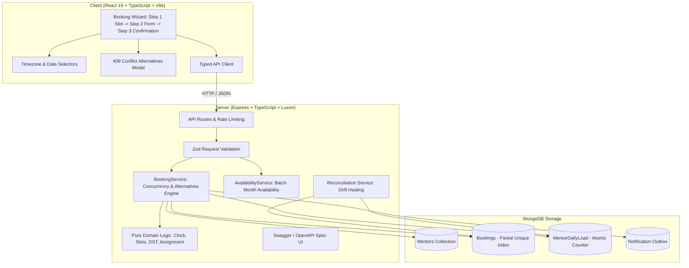

# Codeyoung Trial Class Booking System

A production-grade, demo-ready trial-class booking platform engineered for **Codeyoung**. Parents in the US, UK, and Ireland can seamlessly discover and book 1:1 live trial coding sessions with expert mentors based in India (`Asia/Kolkata`).

The system handles multi-continent time zones, Daylight Saving Time (DST) boundaries, strict mentor daily load caps, and high-concurrency booking races without double-booking.

---

## 📸 Visual Demo & Screenshots

<!-- Place animated demo GIF or UI screenshots here -->
| Booking Experience (3 Steps) | Calendar Availability & Conflict Handling |
| :---: | :---: |
|  |  |

---

## 🚀 Key Highlights & Architecture

- **Clean Monorepo**: Node.js/Express TypeScript backend + Vite React 19 TypeScript frontend.
- **Strict Concurrency Safety (No Replica Set Required)**: Works reliably on standalone MongoDB by combining atomic single-document operations (`$inc` on `MentorDailyLoad`) with MongoDB compound unique partial indexes (`{ mentorId: 1, slotStartUtc: 1 }` where `status: 'CONFIRMED'`) and compensation rollbacks.
- **Multi-Zone & DST Resilience**: Powered entirely by Luxon. Database stores strictly normalized UTC ISO timestamps. Slot generation respects parent local calendar days, detects Arizona (no DST), UK (BST/GMT), and US Eastern/Pacific transitions, mapping precisely to Indian Standard Time (IST, UTC+5:30).
- **Mentor Daily Capacity Rules**: Hard limit of **maximum 2 trial classes per mentor per local calendar day (IST)**.
- **Load Balancing Strategy**: Implements a pluggable `LeastLoadedStrategy` to distribute incoming trials fairly across all working mentors for each slot.
- **Clock Injection for Test Independence**: Domain and service layers use an injectable `Clock` (`SystemClock` in production, `FixedClock` in tests), guaranteeing tests never fail due to the passage of real time.
- **Idempotent Requests**: Full support for `Idempotency-Key` HTTP headers preventing duplicate bookings on double-clicks or network retries.
- **Graceful Conflict & Alternatives UX**: When a slot is taken or mentor capacity is exhausted, the API returns a structured HTTP 409 with recommended alternative slots sorted by closeness for instant re-selection.
- **Interactive Calendar Integration**: Instant one-click RFC 5545 `.ics` file download and direct Google Calendar integration.
- **Interactive OpenAPI / Swagger Documentation**: Available at `/api/docs`.

---

## 🏛️ System Architecture



---

## 📂 Project Structure

```
codeyoung-trial-booking/
├── docker-compose.yml          # Standalone MongoDB container
├── package.json                # Monorepo root scripts (dev, build, test, lint, seed, reconcile)
├── .env.example                # Documented environment variable template
├── server/
│   ├── src/
│   │   ├── config/             # Environment & business rules config
│   │   ├── domain/             # Pure domain logic (Clock, slots, DST, timezones, assignment)
│   │   │   ├── slots.ts
│   │   │   ├── slots.test.ts   # 58 domain unit tests (DST, midnight shifts, UTC, clock invariance)
│   │   │   ├── assignment.ts
│   │   │   └── assignment.test.ts
│   │   ├── models/             # Mongoose schemas & indexes
│   │   ├── routes/             # Express endpoints & rate limiting
│   │   │   ├── bookings.ts
│   │   │   ├── bookings.test.ts # 28 integration tests (races, edge cases, outbox, DST)
│   │   │   ├── slots.ts
│   │   │   ├── mentors.ts
│   │   │   └── timezones.ts
│   │   ├── services/           # BookingService, AvailabilityService, NotificationService, Reconciliation
│   │   │   ├── reconciliation.ts
│   │   │   └── reconciliation.test.ts # Leak simulation & reconciliation tests
│   │   ├── utils/              # Injectable Clock, errors, logger
│   │   ├── seed/               # 10 Indian mentors + demo bookings + reconcile CLI
│   │   └── docs/               # Swagger / OpenAPI specification
│   ├── vitest.config.ts
│   └── package.json
└── client/
    ├── src/
    │   ├── api/                # Typed API client with error handling
    │   ├── components/         # UI Components
    │   │   ├── Header.tsx      # Portal navigation & timezone indicator
    │   │   ├── TimezoneSelector.tsx # Searchable timezone selector + presets
    │   │   ├── DateStrip.tsx   # 14-day bookable window carousel with full/limited badges
    │   │   ├── SlotGrid.tsx    # Morning/Afternoon/Evening slot grid
    │   │   ├── BookingForm.tsx # Step 2 details form with inline validation
    │   │   ├── ConfirmationCard.tsx # Step 3 confirmation, .ics, cancel
    │   │   ├── MentorSchedule.tsx   # Mentor daily rosters portal
    │   │   ├── SystemStats.tsx # Invariants verification dashboard
    │   │   └── ConflictModal.tsx    # 409 slot alternative dialog
    │   ├── test/               # React Testing Library + Vitest client test suite
    │   │   └── booking.test.tsx # 6 comprehensive component tests
    │   ├── utils/              # Luxon date formatters & RFC 5545 .ics generator
    │   ├── types/              # TypeScript interface definitions
    │   └── index.css           # Modern design system & Tailwind styling
    ├── vitest.config.ts
    └── vite.config.ts
```

---

## ⚡ Quick Start & Commands

### 1. Prerequisites
- **Node.js**: v18+ (v20+ recommended)
- **MongoDB**: Either local MongoDB or Docker container

### 2. Start MongoDB (via Docker)
```bash
docker compose up -d
```

### 3. Install Dependencies
```bash
npm install
```

### 4. Configuration
Create a `.env` file at the repository root by copying the documented template:
```bash
cp .env.example .env
```

| Environment Variable | Default | Purpose |
|---|---|---|
| `PORT` | `3001` | Express server port |
| `NODE_ENV` | `development` | Node execution environment |
| `MONGODB_URI` | `mongodb://localhost:27017/codeyoung-trial-booking` | MongoDB connection string |
| `CORS_ORIGIN` | `http://localhost:5173` | Allowed CORS origin for Vite client |
| `SLOT_DURATION_MINUTES` | `30` | Duration of each trial class session |
| `SLOT_INTERVAL_MINUTES` | `30` | Interval between start of consecutive slots |
| `MAX_BOOKINGS_PER_MENTOR_PER_DAY` | `2` | Hard capacity cap per mentor per IST calendar day |
| `MIN_LEAD_TIME_HOURS` | `2` | Minimum advance notice required before slot start |
| `BOOKABLE_WINDOW_DAYS` | `14` | Forward booking horizon |
| `RATE_LIMIT_WINDOW_MS` | `60000` | Rate limiter observation window (1 minute) |
| `RATE_LIMIT_MAX_REQUESTS` | `100` | Max requests per IP per window |

### 5. Seed Database (Idempotent)
Seeds the 10 Indian mentors with their respective working windows (`15:00–00:00 IST` and `20:00–05:00 IST`):
```bash
npm run seed
```
*(Optional: run `npm run seed:demo` to seed mentors along with ~20 sample confirmed bookings across the week).*

### 6. Run the Application
Starts both the backend (`http://localhost:3001`) and frontend (`http://localhost:5173`) concurrently:
```bash
npm run dev
```

- **Frontend App**: Open [http://localhost:5173](http://localhost:5173) in your browser.
- **Swagger Documentation**: Open [http://localhost:3001/api/docs](http://localhost:3001/api/docs).

### 7. Run Daily Load Reconciliation
Recomputes actual booking counts from `CONFIRMED` bookings and corrects any counter drift:
```bash
# Reconcile all dates
npm run reconcile

# Or reconcile a specific mentor local date (IST)
npm run reconcile -- 2026-10-18
```

### 8. Run Verification & Tests
```bash
# Run full test suite (102 tests across server and client)
npm test

# Run backend tests only (96 tests)
npm run test:server

# Run client tests only (6 tests)
npm run test:client

# Run lint checks across all workspaces
npm run lint

# Build production bundles for backend and frontend
npm run build
```

---

## 🌍 Time Zone and DST Design

### 1. Normalized UTC Storage
All timestamps (`slotStartUtc`, `slotEndUtc`, `createdAt`) are stored as ISO 8601 UTC instants in MongoDB. Time zone conversions are applied strictly at the boundary:
- When a parent queries availability for their local date (`GET /api/slots?date=2026-10-18&tz=America/New_York`), the server converts the parent's local day boundaries into UTC instants.
- When evaluating mentor working hours and daily capacity, UTC instants are converted to `Asia/Kolkata` (IST, UTC+5:30).

### 2. Multi-Continental IANA Time Zones
The system supports all standard IANA time zones with curated presets for Codeyoung's primary markets:
- **US**: `America/New_York` (ET), `America/Chicago` (CT), `America/Denver` (MT), `America/Los_Angeles` (PT), `America/Anchorage` (AKT), `Pacific/Honolulu` (HT), `America/Phoenix` (no DST).
- **UK**: `Europe/London` (GMT/BST).
- **Ireland**: `Europe/Dublin` (GMT/IST).
- **India**: `Asia/Kolkata` (IST - mentor operations).

### 3. Handling 23-Hour and 25-Hour Days (DST Transitions)
- **Spring-Forward (23-Hour Day, e.g. US 2026-03-08)**:
  At 2:00 AM local time, clocks jump to 3:00 AM. The 2:00 AM–2:59 AM hour does not exist. Slot generation operates on UTC instants derived from the parent day's boundaries. The nonexistent hour is never produced, preventing invalid slots.
- **Fall-Back (25-Hour Day, e.g. US 2026-11-01)**:
  Clocks repeat 1:00 AM–1:59 AM. Two distinct UTC instants represent 1:30 AM (the first at UTC-4 EDT, the second at UTC-5 EST). The generator produces **both** slots and labels them distinctly (`1:30 AM EDT` vs `1:30 AM EST`), allowing parents to book either occurrence without ambiguity.
- **US vs. UK/Ireland Transition Differences**:
  The US transitions on the second Sunday of March and first Sunday of November. The UK/Europe transitions on the last Sunday of March and last Sunday of October. Between these dates, the time difference between London and New York shifts from 5 hours to 4 hours. Because slot intervals and working windows are converted via IANA zone definitions in Luxon, this multi-week transatlantic desynchronization is handled automatically without hardcoded offsets.

### 4. Midnight Rollover & The "Cross-Date" Rule
A US evening class (e.g., 9:00 PM EDT on October 18) corresponds to 6:30 AM IST on October 19. The booking counts against the mentor's **October 19 IST date**, never the parent's October 18 date. The system computes `mentorLocalDate = getMentorLocalDate(slotStartUtc, mentor.timezone)` for every slot and stores it alongside the booking.

---

## 🔒 Concurrency Design

### The Two-Phase Race Prevention Strategy (No Multi-Document Transactions)
Standard MongoDB transactions require a replica set or MongoDB Atlas cluster. To provide enterprise-level concurrency safety on standalone MongoDB instances, this system uses a two-phase protocol:

```
Step 1: Atomic Increment on MentorDailyLoad
   findOneAndUpdate(
     { mentorId, mentorLocalDate: 'YYYY-MM-DD', count: { $lt: 2 } },
     { $inc: { count: 1 } },
     { upsert: true, returnDocument: 'after' }
   )
   - If mentor already has 2 bookings for that IST date, the query does not match.
   - The mentor is skipped and the engine evaluates the next candidate.

Step 2: Insert into Bookings Collection
   Booking document inserted with status: 'CONFIRMED'.
   Protected by a Compound Partial Unique Index:
     { mentorId: 1, slotStartUtc: 1 } where status: 'CONFIRMED'
   - Success: Booking confirmed!
   - MongoServerError E11000 (race condition): Another request claimed this mentor for this slot.
     Compensation Rollback: $inc: { count: -1 } on MentorDailyLoad.
     The engine immediately falls back to the next available mentor.

Step 3: Candidate Exhaustion & Alternatives
   If all candidate mentors are occupied:
   - System throws SlotUnavailableError (HTTP 409).
   - Generates nearby available slots sorted by closeness (|alternativeSlot - requestedSlot|)
     and returns them in the error response.
```

### Idempotency & Duplicate Prevention
- **`Idempotency-Key` Header**: Clients can send a UUID or unique key with booking requests. If a booking with the same idempotency key already exists, the server returns the existing booking immediately with HTTP 201 without creating duplicates.
- **Parent Duplicate Shield**: Unique partial index prevents the same parent email from double-booking the same UTC slot.
- **Idempotent Cancellation**: Calling `DELETE /api/bookings/:ref` on an already cancelled booking returns HTTP 200 without decrementing the daily counter twice.

### Counter-Leak Safety & Mitigation
If a server process crashes abruptly between the `$inc` in Step 1 and the insert in Step 2, a counter drift could occur (the daily load counter would read 1 higher than actual confirmed bookings).
- **Mitigation**: The system includes a dedicated `reconcileMentorDailyLoad(mentorLocalDate?)` engine.
- Recomputes counts directly from `CONFIRMED` bookings using a single aggregation pipeline.
- Automatically repairs drifted counters and creates missing load records.
- Run anytime via `npm run reconcile`.

---

## 🌐 API Documentation Summary

The API is fully documented with OpenAPI 3.0 / Swagger UI at **`http://localhost:3001/api/docs`**.

| Method | Endpoint | Description |
|---|---|---|
| `GET` | `/api/health` | Health check endpoint returning uptime and database status |
| `GET` | `/api/timezones/suggested` | Suggested IANA time zones grouped by region |
| `GET` | `/api/slots?date=YYYY-MM-DD&tz=...` | Returns 30-min slots for parent local date with availability and IST times |
| `GET` | `/api/availability/calendar?month=YYYY-MM&tz=...` | Returns per-day availability (`hasAvailability`, `limited`) in a single query |
| `POST` | `/api/bookings` | Creates a trial booking; supports `Idempotency-Key` header |
| `GET` | `/api/bookings/:bookingRef` | Retrieves booking details by reference code |
| `DELETE` | `/api/bookings/:bookingRef` | Cancels booking, restores mentor capacity and daily load |
| `GET` | `/api/mentors` | Returns list of 10 mentors with bio and working windows |
| `GET` | `/api/mentors/:id/schedule?date=...` | Returns mentor schedule and IST daily load counter |
| `GET` | `/api/docs` | Interactive Swagger / OpenAPI documentation UI |

---

## 🎯 Assumptions & Trade-offs

1. **30-Minute Fixed Slots**: Trial classes are strictly 30 minutes in length, starting on 30-minute intervals. We chose fixed intervals over arbitrary durations to maximize slot alignment across mentors and time zones.
2. **Mentor Day = Asia/Kolkata Calendar Day**: Capacity counting is strictly evaluated in `Asia/Kolkata` (00:00 to 23:59 IST). This respects mentors' natural biological workday regardless of where parents reside.
3. **2-Hour Lead Time**: Parents cannot book slots starting within 2 hours of current time. This guarantees mentors have notice and preparation time.
4. **14-Day Booking Horizon**: Parents can book up to 14 days in advance. Research shows trial attendance drops sharply when scheduled further than 2 weeks out.
5. **Least-Loaded Assignment**: Incoming trials are routed to the mentor with the fewest booked classes that day. This prevents burnout and balances work evenly.
6. **No Parent Authentication**: Parents book trials with their name and email without password registration. Removing authentication friction dramatically increases trial booking conversion rates.
7. **Simulated Notification Outbox**: Notifications are written to a durable MongoDB `notifications` outbox collection. This decouples booking transactions from external SMTP email providers and makes message payloads directly inspectable during testing.

### Mentor Shift Schedule & International Working Windows

To provide comprehensive global coverage while enabling US parents to book trial sessions in the evening, the 10 mentors are distributed across three strategic shifts:

| Shift Group | Mentors | IST Shift (UTC+5:30) | US Eastern (ET: EDT/EST) | US Pacific (PT: PDT/PST) | UK / Ireland (BST/GMT) | Coverage Window |
|---|---|---|---|---|---|---|
| **Shift 1 (Afternoon)** | 4 mentors (Aarav, Priya, Rohan, Ananya) | `15:00 – 00:00 IST` | `05:30 – 14:30 EDT`<br>`04:30 – 13:30 EST` | `02:30 – 11:30 PDT`<br>`01:30 – 10:30 PST` | `10:30 – 19:30 BST`<br>`09:30 – 18:30 GMT` | UK Daytime & Evening; US Morning & Early Afternoon |
| **Shift 2 (Night)** | 3 mentors (Vikram, Neha, Arjun) | `20:00 – 05:00 IST` | `10:30 – 19:30 EDT`<br>`09:30 – 18:30 EST` | `07:30 – 16:30 PDT`<br>`06:30 – 15:30 PST` | `15:30 – 00:30 BST`<br>`14:30 – 23:30 GMT` | UK Late Evening; US Afternoon & Early Evening |
| **Shift 3 (Late Night / US Evening)** | 3 mentors (Kavya, Siddharth, Divya) | `22:00 – 08:00 IST` | `12:30 – 22:30 EDT`<br>`11:30 – 21:30 EST` | `09:30 – 19:30 PDT`<br>`08:30 – 18:30 PST` | `17:30 – 03:30 BST`<br>`16:30 – 02:30 GMT` | **US Evening (up to 10:30 PM EDT / 9:30 PM EST)**; US PT Evening |
| **Full Overlap Window** | **All 10 mentors active** | `22:00 – 00:00 IST` | `12:30 – 14:30 EDT`<br>`11:30 – 13:30 EST` | `09:30 – 11:30 PDT`<br>`08:30 – 10:30 PST` | `17:30 – 19:30 BST`<br>`16:30 – 18:30 GMT` | Peak Transatlantic Capacity (all 10 mentors available) |

---

## 🔍 Research Notes: Calendly & Cal.com Comparison

| Dimension | Calendly | Cal.com | Our Implementation |
|---|---|---|---|
| **Timezone Storage** | Normalizes all events to UTC ISO 8601; converts on client based on browser or chosen selector. | Stores UTC timestamps; renders via Luxon / dayjs client-side. | Normalizes all slots and bookings to UTC; Luxon handles zone conversions and DST boundaries. |
| **DST Handling** | Preserves wall-clock local time; recalculates UTC offset across DST boundaries. | Generates recurring slots against IANA zone definitions; tags with offset. | Derives UTC boundaries from parent local dates; disambiguates fall-back duplicate hours with zone abbreviations (EDT vs EST). |
| **Round-Robin Assignment** | Round-robin with priority weights and availability pooling. | Dynamic round-robin, least-recently-booked, or random distribution. | Deterministic `LeastLoadedStrategy` (prioritizes mentor with lowest IST daily count; falls back to mentor ID). |
| **Concurrency & Double Booking** | External calendar lock (Google/Outlook busy polling) + database transactional lock. | Postgres advisory locks + Prisma transactional queries. | Atomic MongoDB `$inc` counter + compound unique partial index on `{ mentorId, slotStartUtc }` + compensation rollback. |

### What We Deliberately Did Not Build
- **Two-way Google/Outlook Calendar Sync**: Cal.com connects to mentors' personal Google Calendars via OAuth. For this trial booking app, mentor working shifts are managed directly in the system to avoid third-party API rate limits and external synchronization failures.
- **Complex Multi-Host Booking**: Group or collective bookings (requiring 2+ mentors) were omitted because Codeyoung trial classes are strictly 1:1.
- **Recurring Bookings**: Trial sessions are single-event discovery experiences; subscriptions happen post-trial.

---

## ⚠️ Known Limitations & Future Improvements

1. **Distributed Concurrency at 100k+ Scale**:
   *Current*: Standalone atomic counter + partial index rollback.
   *Future*: Migrate to Redis distributed locks (`Redlock`) or MongoDB replica-set multi-document transactions when scaling beyond single-instance workloads.
2. **Real Email & Calendar Dispatch**:
   *Current*: Durable outbox collection with simulated email dispatch.
   *Future*: Integrate SendGrid / Resend with BullMQ background worker queues and dynamic Google Meet / Zoom meeting link generation.
3. **Mentor Availability Self-Service**:
   *Current*: Shift windows seeded in database.
   *Future*: Dedicated mentor dashboard to set PTO, vacation dates, and custom shifts.
4. **Observability**:
   *Current*: Structured JSON logging with Pino.
   *Future*: Add OpenTelemetry distributed tracing and Prometheus metrics for slot request latencies and conflict rates.

---

## 🤖 How I Used AI

This project was built using an AI-assisted, **planning-first workflow**:

1. **Specification & Plan First**:
   Before writing implementation code, I drafted a comprehensive architectural contract covering data models, time zone invariants, concurrency strategies, and test matrices. This prevented architectural drift and scope creep.
2. **Phase-by-Phase Development**:
   - **Phase 1 (Domain)**: Pure Luxon time zone math, DST fall-back/spring-forward test suite, and mentor shift cross-midnight logic.
   - **Phase 2 (Database & Concurrency)**: Schema design with partial indexes, atomic `$inc` counters, and the 25-request concurrency test harness.
   - **Phase 3 (API & Swagger)**: Express routes, Zod schemas, error middleware, and interactive OpenAPI documentation.
   - **Phase 4 (Frontend Experience)**: Responsive React 19 UI, timezone selector, date strip with availability indicators, slot grid, and conflict modal.
   - **Phase 5 (Hardening & Edge Cases)**: Injectable clock abstraction for zero-expiry tests, batch calendar availability, reconciliation tooling, and comprehensive unit tests.
3. **Key Corrections & Adaptations Made**:
   - *Clock Injection*: Initial tests called `DateTime.now()`, which would cause tests to expire over time. We refactored to an injectable `Clock` pattern (`FixedClock`) pinning tests to deterministic points in time.
   - *Standalone MongoDB Concurrency*: Rather than assuming replica sets, we engineered the two-phase atomic counter + partial unique index + compensation rollback pattern.
   - *Time Zone Abbreviations*: Handled Luxon's default `GMT+5:30` format for `Asia/Kolkata` by explicitly formatting as `IST` to align with parent and mentor expectations.
   - *HTML5 Validation in JSDOM*: Added `noValidate` on the booking form so React Testing Library tests execute custom React error validation without browser native intervention.
